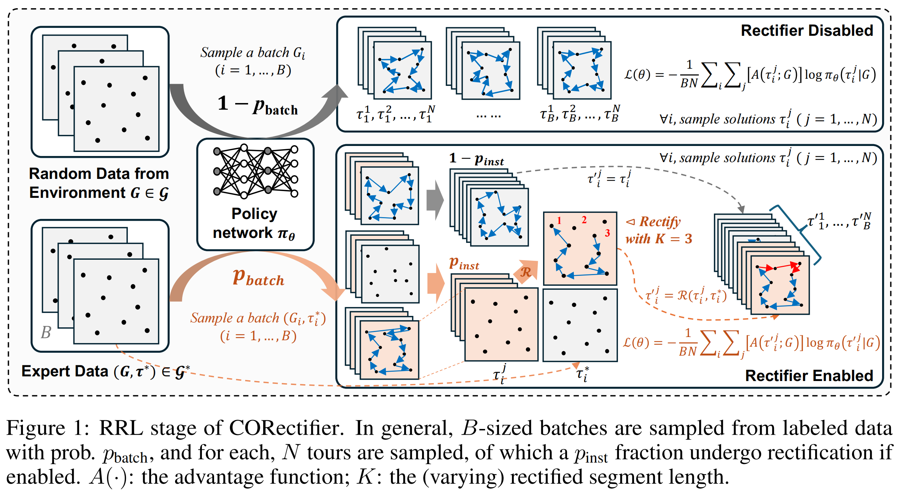

# ✨ CORectifier

This is the official implementation of our NeurIPS 2026 paper "[**Hierarchically Rectifying Policy Rollouts for Reinforcement Learning in Combinatorial Solvers**](https://openreview.net/forum?id=bpt10w03zk)".

**Authors**: [**Wenzheng Pan**](https://wzever.github.io/) · [**Nuoyan Chen**](https://cny123222.github.io/about/) · [**Jiaxi Liu**](https://ecthelionliu.github.io) · [**Jiale Ma**](https://heatingma.github.io/) · [**Junchi Yan**](https://thinklab.sjtu.edu.cn)

[](paper_preview.pdf) [[paper preview](paper_preview.pdf)]

CORectifier gives policy-gradient solvers useful action-level supervision without breaking feasibility. During training, a hierarchical **batch → trajectory → segment** gate selectively replaces a policy action with the feasible successor from an expert tour, then continues the rollout from the executed state. The policy is optimized with the resulting rollout reward and likelihoods; at inference time, the model is used normally with no expert data or rectifier.



## 🌟 What the paper adds

- **State-consistent guidance:** every replacement is checked against the current feasible state, so sequential constraints remain intact.
- **Three levels of control:** batch, trajectory and contiguous segment gates regulate when and how much expert information enters training.
- **One training recipe across CO:** the release covers TSP, ATSP, CVRP, KP and PCTSP, with TSPLIB and CVRPLIB evaluation entries.
- **Better scaling for RL:** the paper reports strong gains through 500-node routing instances while keeping greedy inference lightweight.

## 🧰 Install

Linux, Python 3.8, PyTorch with CUDA and a C/C++ compiler are the tested setup.

```bash
conda create -n corectifier python=3.8
conda activate corectifier
pip install -r requirements.txt
make -C ATSP/utils
make -C CVRP/utils/c_local_search
```

Entries default to `cuda:0`. Set `USE_CUDA=False` in a POMO/MatNet script or `opts.no_cuda=True` for PCTSP to run on CPU.

## 🗂️ Repository map

```text
TSP/ ATSP/ CVRP/ KP/       POMO/MatNet tasks and train/test entry points
PCTSP/                       Attention Model task
weights/                     19 released checkpoints (main rows + CVRPLIB-100)
data/{train,test}/          ignored datasets; keep the .gitkeep files
assets/fig1.png              paper overview figure
```

The task layout follows the original research code. Every resource path in an entry is relative to the repository and is declared in explicit dictionaries such as `TEST_PATH_DICT`, `TRAIN_FOLDER_DICT`, `VAL_PATH_DICT` and `WEIGHT_DICT`.

## 📦 Data

Datasets are intentionally excluded from Git. Keep `data/train/.gitkeep` and `data/test/.gitkeep`, then place files using the paths declared by the selected task script. The public ML4CO sources are [test archive](https://drive.google.com/file/d/1tLQBUBAMJLIcW3KtS5gSXzuuKmdG9VOD/view?usp=share_link) and [training dataset](https://huggingface.co/datasets/ML4CO/ML4CO-Bench-101-SL/tree/main/train_dataset). The repository includes one tiny labeled training example per supported scale for a smoke test; replace it with full shards for training. PCTSP also needs its matching `*_val.txt` and `*_cost.txt` files.

Synthetic main-task scales match the released checkpoints: TSP **50/100/500**, ATSP **50/100/200/500**, CVRP **50/100/200/500**, KP **50/100/200/500**, and PCTSP **20/50/100**. Larger instances are available only through the TSPLIB/CVRPLIB extension files.

## 🚀 Evaluate

```bash
python TSP/test_tsp.py
python ATSP/test_atsp.py
python CVRP/test_cvrp.py
python KP/test_kp.py
python PCTSP/test/test_pctsp.py
```

Defaults are the smallest supported checkpoint, one instance, augmentation **16**, CUDA device **0**, TSP/ATSP **2-opt**, and CVRP **classic local search**. Increase `num_instances` (or PCTSP `opts.val_size`) to reproduce the paper table counts: TSP-50/100 **1,280**, TSP-500 **128**; ATSP-50/100 **2,500**, ATSP-200/500 **100**; CVRP-50/100 **10,000**, CVRP-200/500 **100**; KP **1,280** per scale; PCTSP **10,000** per scale. Set `NUM_AUG`/`aug_factor` to the paper row (`1`, `16` or `128`) as needed.

For real-world generalization:

```bash
python TSP/test_tsplib.py
python CVRP/test_cvrplib.py
```

The TSPLIB/CVRPLIB scripts enumerate the copied library files and select a compatible released model through their explicit `WEIGHT_DICT`.

## 🏋️ Train

```bash
python TSP/train_tsp.py
python ATSP/train_atsp.py
python CVRP/train_cvrp.py
python KP/train_kp.py
python PCTSP/train_pctsp.py
```

Training defaults are deliberately minimal: one epoch, one sample, batch size 1, CUDA device 0, augmentation 16, and no checkpoint warm start. **Rectifier is enabled** (`USE_LABEL=True` or `opts.use_label=True`) and imitation loss is disabled (`IL_loss=False`, `USE_IL=False` or `opts.il_loss=False`). TSP/ATSP use 2-opt during validation; CVRP uses local search. Replace the toy shard and raise the limits in the entry script for a full run.

## 🎛️ Rectifier knobs

| Setting | Meaning |
| --- | --- |
| `use_label` / `USE_LABEL` | Enable expert-labeled batches during training. |
| `label_prob` | Batch-level probability of choosing labeled data. |
| `instance_prob` | Fraction gate for trajectories/instances selected for rectification. |
| `rect_range=[α, β]` | TSP/ATSP/PCTSP segment fraction sampled for replacement. |
| `act_prob` | CVRP route gate; TSP/ATSP/PCTSP keep it at `1.0` and use their segment masks. |
| `IL_loss` / `opts.il_loss` | Optional imitation objective; disabled by default. |

The reference tour is used only while training. The executed action is rescored by the policy, preserving the original RL objective and feasibility checks.

## 📚 Acknowledgements

The implementations build on [POMO](https://github.com/yd-kwon/POMO), [MatNet](https://github.com/yd-kwon/MatNet), [AM](https://github.com/wouterkool/attention-learn-to-route), and [ML4CO-Kit](https://github.com/Thinklab-SJTU/ML4CO-Kit).